# ggtk

A compact, slightly darker take on Adwaita for GTK3, GTK4 and libadwaita apps,
and for GNOME Shell.

ggtk is built on top of [adw-gtk3](https://github.com/lassekongo83/adw-gtk3)
(for GTK3 and plain GTK4 apps), on libadwaita's own stylesheet (for
libadwaita apps) and on GNOME Shell's own stylesheet (for the shell).
Compared to stock Adwaita it has:

- **Much less padding everywhere.** Headerbars, buttons, entries, menus,
  popovers, list rows, sidebars, tabs, toolbars and dialogs are all tighter.
  Headerbars go from 47px to about 33px and buttons from 34px to 24px. In
  GNOME Shell, the top bar (26px), quick settings, the calendar and
  notifications, menus, the dash and dialogs get the same treatment.
- **Proportional corners.** Corner radii shrink by the same factor as the
  padding (buttons 9px → 4px, popovers and menus about half). Pills and
  circles stay round.
- **A darker dark variant.** It uses neutral grays with no blue tint, a
  notch below Adwaita's dark (inspired by the *Hardcore* color scheme):

  | Surface            | Adwaita dark | ggtk dark |
  |--------------------|--------------|-----------|
  | Window             | `#222226`    | `#1a1a1a` |
  | Views              | `#1d1d20`    | `#141414` |
  | Headerbar          | `#2e2e32`    | `#222222` |
  | Sidebar            | `#2e2e32`    | `#202020` |
  | Popovers / dialogs | `#36363a`    | `#262626` |

- **The same accent colors as Adwaita.** libadwaita apps follow the GNOME
  accent color setting.

The light variant has only the padding changes.

## Screenshots

| | Stock | ggtk |
|---|---|---|
| libadwaita (dark) | 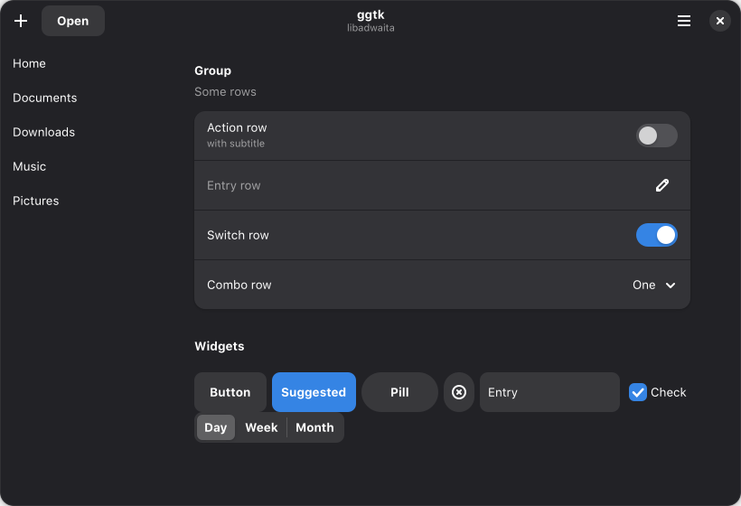 | 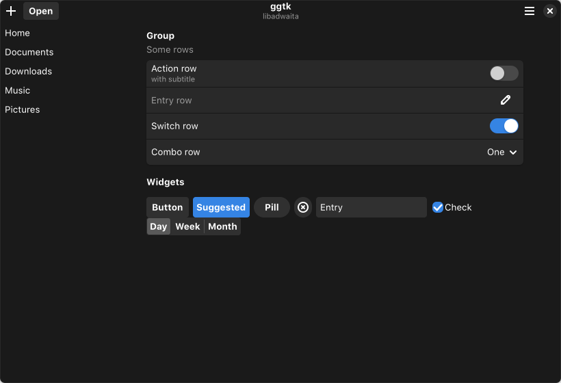 |
| GTK3 (dark) | 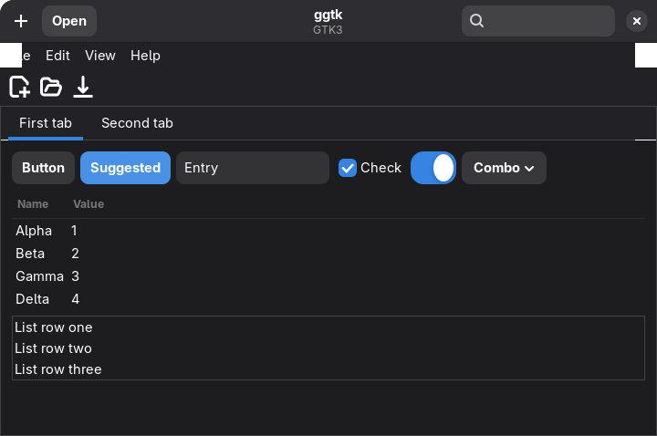 | 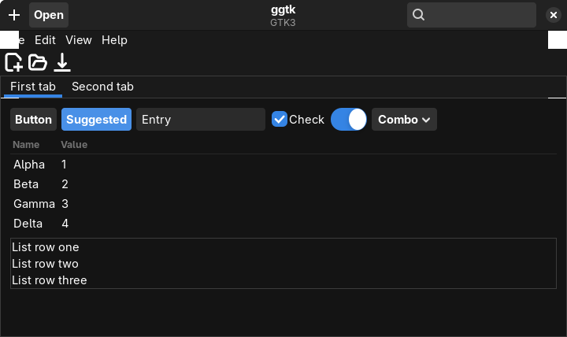 |
| Shell quick settings | 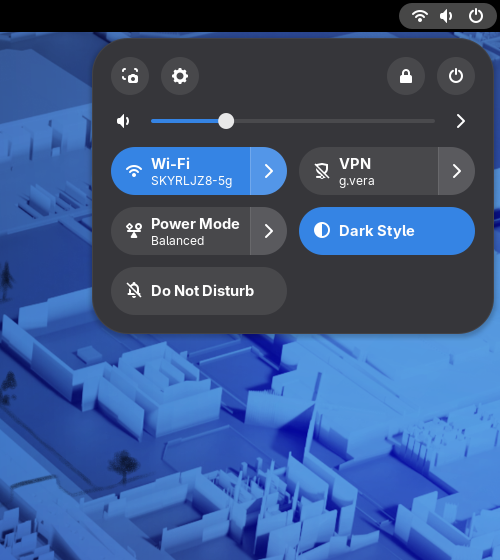 | 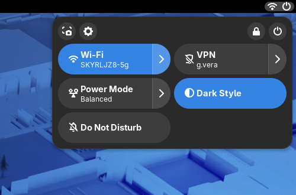 |
| Shell calendar | 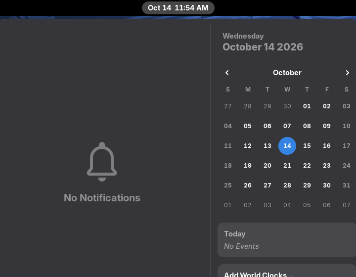 | 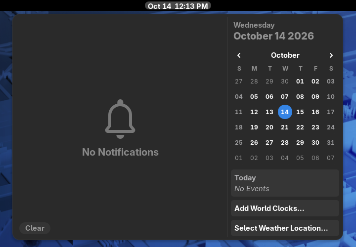 |
| Shell, `ggtk` in light mode | | 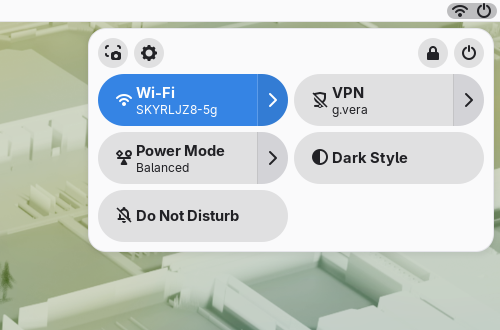 |

| libadwaita (light) | Menu |
|---|---|
| 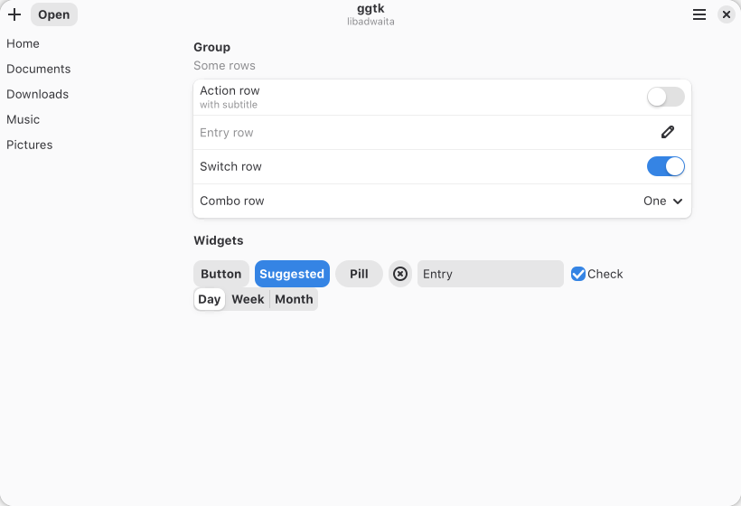 | 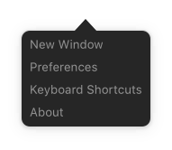 |

## Requirements

- `bash` and `python3` (the stylesheets are generated at install time)
- GTK ≥ 4.16 / libadwaita ≥ 1.6 for the libadwaita part. It uses the CSS
  variables and `prefers-color-scheme` media queries that these versions added.
- Optional: `gresource` (from glib2), which lets the build read the exact
  stylesheet of your installed libadwaita.
- Optional: `flatpak`, for the Flatpak overrides.
- For the shell theme: GNOME Shell (the build reads its stylesheet, so it
  needs `gresource`) and the
  [User Themes](https://extensions.gnome.org/extension/19/user-themes/)
  extension (on Fedora: `gnome-shell-extension-user-theme`).

## Install

```sh
./install.sh                 # per-user install (recommended)
./install.sh --system        # themes to /usr/share/themes (uses sudo)
```

Then select the theme for GTK3 and plain GTK4 apps:

```sh
gsettings set org.gnome.desktop.interface gtk-theme 'ggtk-dark'   # or 'ggtk'
gsettings set org.gnome.desktop.interface color-scheme 'prefer-dark'
```

You can also pick it in GNOME Tweaks under *Appearance → Legacy
Applications*. libadwaita apps don't need any setting, but they have to be
restarted.

For GNOME Shell, enable User Themes and select the theme:

```sh
gnome-extensions enable user-theme@gnome-shell-extensions.gcampax.github.com
dconf write /org/gnome/shell/extensions/user-theme/name "'ggtk-dark'"   # or 'ggtk'
```

You can also pick it in GNOME Tweaks under *Appearance → Shell*. The two
variants behave differently:

| Shell theme | Light/dark | Colors |
|---|---|---|
| `ggtk` | Follows the system style | Stock Adwaita shell colors, only the sizes change |
| `ggtk-dark` | Always dark | The darker neutral palette |

GNOME Shell can't do both at once: its CSS has no way to switch colors by
color scheme, and a theme stylesheet is a single fixed file.

What the installer does:

| Part | Where | Notes |
|---|---|---|
| GTK3 + plain GTK4 themes | `~/.local/share/themes/ggtk{,-dark}`, or `/usr/share/themes` with `--system` | |
| GNOME Shell theme | `gnome-shell/gnome-shell.css` inside the same theme directories | Generated from the installed GNOME Shell. Skipped if it isn't found. |
| libadwaita override | `~/.config/gtk-4.0/ggtk.css`, plus an `@import` block at the top of `~/.config/gtk-4.0/gtk.css` | Always per user. An existing `gtk.css` is kept and backed up to `gtk.css.ggtk-backup`. |
| Flatpak | `flatpak override --user --filesystem=xdg-data/themes:ro --filesystem=xdg-config/gtk-4.0:ro` | Only adds what's missing, and remembers what it added so uninstall can remove exactly that. |

Options:

```
--system           install themes system-wide (uses sudo)
--density PRESET   dense (default), compact or mild
--no-libadwaita    don't touch ~/.config/gtk-4.0
--no-flatpak       don't add Flatpak overrides
```

`./install.sh status` shows what is installed.

## Uninstall

To remove ggtk completely:

```sh
./uninstall.sh
```

This removes:
- the themes, per user and system-wide (it asks for sudo only if a
  system-wide install exists)
- the libadwaita override and its import block in `gtk.css`. The rest of your
  `gtk.css` is left as it was.
- only the Flatpak permissions the installer added
- the `build/` output

It also resets the GTK theme and GNOME Shell theme settings, but only if they
still point at ggtk. Pass `--keep-settings` to leave them alone, or
`--keep-build` to keep `build/`. Log out and back in afterwards so the shell
and running apps drop the theme.

`./install.sh uninstall [--system]` does the same removal without touching
settings or `build/`.

## How it works

libadwaita apps **ignore GTK themes** and always load the stylesheet compiled
into libadwaita. The only supported way to restyle them is
`~/.config/gtk-4.0/gtk.css`, which GTK loads at *user* priority. At that
priority a rule beats every libadwaita rule regardless of specificity, so a
naive `button { padding: 2px }` would also flatten circular, pill and OSD
buttons.

To avoid that, `scripts/compact.py` reads the upstream stylesheet and re-emits
**every** rule that sets padding, margin, spacing, `min-height`/`min-width` or
a corner radius. It keeps the same selectors in the same order, with
scaled values. Rules whose values don't change are re-emitted too, so the
upstream cascade, special cases included, is reproduced exactly. Geometry that
shouldn't shrink is copied verbatim: scrollbars, sliders, scales, progress
bars, paned handles, shadows and OSD controls. Their corner radii are still
scaled, so rounding stays consistent.

The same generator produces the compact layer for the GTK3 theme (from
adw-gtk3) and for plain GTK4 apps.

GNOME Shell always loads its stock stylesheet, which follows the light/dark
setting, and puts the User Themes stylesheet on top of it. So `ggtk` gets the
same mirrored, sizes-only layer as libadwaita (including St's `spacing` and
`-natural-hpadding` properties), which leaves colors and light/dark to the
stock theme. `ggtk-dark` is a complete stylesheet (`compact.py --full`) that
also turns the shell's bluish grays into the darker neutral grays. Accent
colors are untouched in both, so the shell follows the system accent.

```
src/gtk-3.0/colors-dark.css    darker palette (GTK3 @define-color)
src/gtk-4.0/colors-dark.css    darker palette (libadwaita CSS variables)
src/gtk-*/tweaks-dense.css     a few hand-tuned exceptions for the dense preset
src/gnome-shell/tweaks-dense.css  same, for the shell (top bar height, quick
                               settings, calendar)
scripts/compact.py             the generator
scripts/update-vendor.sh       refresh vendor/adw-gtk3 from a release
vendor/adw-gtk3/               adw-gtk3 v6.5 release CSS + assets
build.sh                       assembles build/themes/* and build/libadwaita/
install.sh                     install / uninstall / status
uninstall.sh                   remove everything, including settings
```

### Tuning

- **Density:** `./install.sh --density compact` (about 30% less padding) or
  `--density mild` (about 15% less). For finer control, edit the factors in
  `build.sh` (`--pad-scale`, `--size-scale`, `--radius-scale`).
- **Colors:** edit `src/gtk-3.0/colors-dark.css` and
  `src/gtk-4.0/colors-dark.css`, then re-run `./install.sh`.
- **GTK3 accent color:** adw-gtk3 uses blue. Override it in
  `~/.config/gtk-3.0/gtk.css`, for example
  `@define-color accent_bg_color #9141ac;`.

### After a GNOME upgrade

The libadwaita override and the shell theme are generated from your installed
libadwaita and GNOME Shell when you install. **After upgrading GNOME, re-run
`./install.sh`.** This matters most for the shell: an outdated shell stylesheet
can leave new shell widgets unstyled.

## Caveats

- **Other tools that write `~/.config/gtk-4.0/gtk.css`** (theme switchers,
  color generators) may drop the `@import` block when they rewrite the file.
  Re-run `./install.sh` afterwards, or add `@import url("ggtk.css");` as the
  first line yourself. If `gtk.css` is a symlink, the installer won't edit it
  and tells you to add the line yourself.
- The libadwaita override applies to **all** GTK4 apps for your user, whatever
  GTK theme is selected. Uninstall to get stock libadwaita back.
- With `--system`, Flatpak apps can't read `/usr/share/themes`, so GTK3
  Flatpak apps need a per-user install.
- Snap apps only use themes shipped as snaps and aren't covered.
- The login screen (GDM) and the lock screen's unlock dialog run separately
  and aren't themed.

## Credits & license

- [adw-gtk3](https://github.com/lassekongo83/adw-gtk3) by lassekongo83 and
  contributors (LGPL-2.1), vendored in `vendor/adw-gtk3`
- [libadwaita](https://gitlab.gnome.org/GNOME/libadwaita) (LGPL-2.1)
- [GNOME Shell](https://gitlab.gnome.org/GNOME/gnome-shell) stylesheet
  (LGPL-2.1), used as the base for the generated shell theme

ggtk is distributed under the same license, LGPL-2.1. See [LICENSE](LICENSE).
